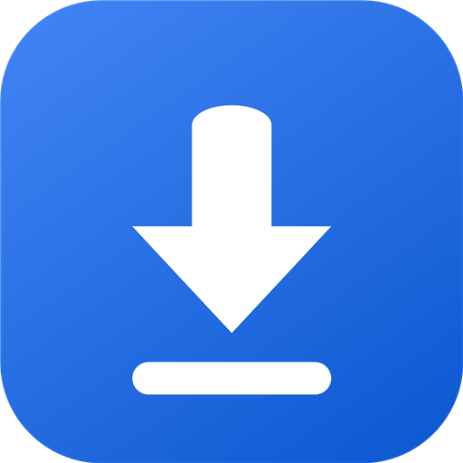

<p align="center">
  
</p>

<h1 align="center">VDown · 全平台视频下载器</h1>

<p align="center">
基于 <b>Flutter（Material 3）+ yt-dlp</b> 的视频下载器，支持 <b>YouTube、Bilibili、X（Twitter）</b> 等 1800+ 网站的<b>全分辨率</b>视频与音频下载。
</p>

## 功能

- 粘贴链接一键解析，展示封面 / 标题 / UP 主 / 时长
- 按分辨率选择清晰度（4K / 1080P60 / 720P …），或仅提取 MP3 音频
- 高清流自动"视频 + 最佳音轨"合并为 MP4（B 站、YouTube 高清均为分离流）
- **YouTube / Bilibili 直播实时录制与断点保存**：采用 FFmpeg fragmented MP4 实时录制 + `faststart` 重封装，支持实时显示录制时长/体积/码率、YouTube DVR「从直播开头录制」、限时录制、任意时间戳「断点保存片段」与「停止并保存」立即生成完整可播放视频
- 下载队列：实时进度 / 速度 / 剩余时间，支持取消、重试、断点续传
- 代理设置（国内访问 YouTube / X 必需）
- 浏览器 Cookie 读取（B 站大会员画质，桌面端）
- **Android 端内置引擎**（yt-dlp + Python 运行时 + FFmpeg 随 APK 打包），安装即用，零配置
- **HarmonyOS 7 原生版**（`harmonyos/`，ArkTS API 26）：适配鸿蒙 7 原生沉浸玻璃材质（`uiMaterial.ImmersiveMaterial` / `systemMaterial` + `HdsTabs` 悬浮玻璃底栏 + `HdsSnackBar`），直连 B 站直播（HLS fMP4 / HTTP-FLV 含解码序列头分段）/ B 站点播 / HLS / FLV / MP4，并支持通过 `tools/vdown_bridge.py` 协同录制 YouTube 直播与 1800+ 站点
- 内置 HarmonyOS Sans SC 字体，全平台渲染一致
- 浅色 / 深色主题，桌面端 NavigationRail、移动端底部导航自适应布局

## 平台支持

| 平台 | 引擎方式 | 状态 |
|------|----------|------|
| Windows / macOS / Linux | 调用本机 yt-dlp + FFmpeg 进程 | ✅ 全功能（含直播实时录制与断点保存） |
| Android（5 个 ABI） | 内置 [youtubedl-android](https://github.com/JunkFood02/youtubedl-android)，平台通道桥接 | ✅ 全功能（含直播实时录制与断点保存） |
| HarmonyOS 7（API 26） | 原生 ArkTS 直播/点播引擎 + 可选 `tools/vdown_bridge.py` 协同服务 | ✅ 原生玻璃 UI + B站/直链直录 + 协同解锁 YouTube 直播 |
| iOS | 系统禁止子进程 | ❌ 需服务端方案 |

## 下载安装

前往 [Releases](../../releases) 页面：

- **Windows（推荐）**：下载 `VDown-*-windows-x64-full.zip` 完整版，解压运行 `vdownload.exe` 即可，**无需安装任何依赖**
- **Windows 精简版**：下载 `VDown-*-windows-x64.zip`，需自行安装引擎：
  ```powershell
  winget install yt-dlp.yt-dlp Gyan.FFmpeg
  ```
- **Android**：下载 `VDown-*-arm64-v8a.apk`（现代手机）直接安装，首次使用建议到「设置 → 更新 yt-dlp 内核」更新一次
- **Linux**：下载 `VDown-*-linux-x64.tar.gz`（由 GitHub Actions 云端构建），解压后运行 `VDown/vdownload`，并安装引擎：
  ```bash
  sudo apt install yt-dlp ffmpeg   # Debian/Ubuntu（或用 pipx install yt-dlp 获取最新版）
  ```
- **macOS**：下载 `VDown-*-macos.zip`（云端构建，未签名，首次打开需右键 →「打开」），并安装引擎：
  ```bash
  brew install yt-dlp ffmpeg
  ```

## 从源码构建

需要 Flutter 3.44+。国内建议先设置镜像：

```powershell
[Environment]::SetEnvironmentVariable('PUB_HOSTED_URL', 'https://pub.flutter-io.cn', 'User')
[Environment]::SetEnvironmentVariable('FLUTTER_STORAGE_BASE_URL', 'https://storage.flutter-io.cn', 'User')
```

```bash
flutter pub get
flutter build windows          # Windows 桌面版（需在 Windows 上）
flutter build apk --release --split-per-abi   # Android（Gradle/Maven 已配置国内镜像）
flutter build linux            # Linux（需在 Linux 上，先装 ninja-build libgtk-3-dev）
flutter build macos            # macOS（需在 macOS 上，先装 Xcode）
```

> Flutter 不支持跨平台编译（Linux 版必须在 Linux 上构建，macOS 同理）。
> 本仓库已配置 GitHub Actions：推送 `v*` 标签会自动在云端构建 Windows / Linux / macOS 三端并附加到对应 Release。
> HarmonyOS 7 原生版源码位于 `harmonyos/`，可使用 DevEco Studio 26.0+ 打开或通过 `hvigorw assembleHap` 构建；如需在鸿蒙端录制 YouTube 直播，可在电脑运行：
> ```bash
> python tools/vdown_bridge.py --port 8765
> ```
> 并在鸿蒙 App 的「设置 → 协同录制服务地址」填入 `http://<电脑局域网IP>:8765`。

## 架构

```
lib/
├── main.dart                       # 入口，Provider 装配
├── theme/app_theme.dart            # Material 3 主题（Google Blue 种子色 + HarmonyOS Sans）
├── models/                         # VideoInfo / VideoFormat / DownloadTask
├── services/
│   ├── engine/
│   │   ├── video_engine.dart       # 引擎抽象接口 + 平台工厂
│   │   ├── desktop_engine.dart     # 桌面端：yt-dlp / FFmpeg fMP4 直播断点录制
│   │   └── android_engine.dart     # Android：MethodChannel 桥接内置引擎与直播分段控制
│   ├── ytdlp_service.dart          # 面向 UI 的解析门面
│   ├── download_manager.dart       # 下载队列、直播进度解析、断点分段/停止保存调度
│   └── settings_service.dart       # 设置持久化
├── ui/
│   ├── home_shell.dart             # 自适应导航（Rail / BottomBar）
│   └── pages/                      # 下载 / 任务 / 设置 三页
└── utils/format_utils.dart

android/.../MainActivity.kt         # youtubedl-android 原生桥接层
harmonyos/                          # HarmonyOS 7 (API 26) 原生玻璃 UI + ArkTS 下载/直播录制工程
tools/vdown_bridge.py               # 面向 HarmonyOS / 局域网客户端的 yt-dlp + FFmpeg 协同录制服务
```

## 致谢

- [yt-dlp](https://github.com/yt-dlp/yt-dlp) — 下载引擎
- [youtubedl-android](https://github.com/JunkFood02/youtubedl-android) — Android 端 yt-dlp 移植
- [HarmonyOS Sans](https://developer.huawei.com/consumer/cn/design/resource/) — 界面字体（许可见 `assets/fonts/LICENSE.txt`）

## 法律提示

请仅下载您拥有权利或获得授权的内容，遵守目标网站的服务条款及当地法律法规。
